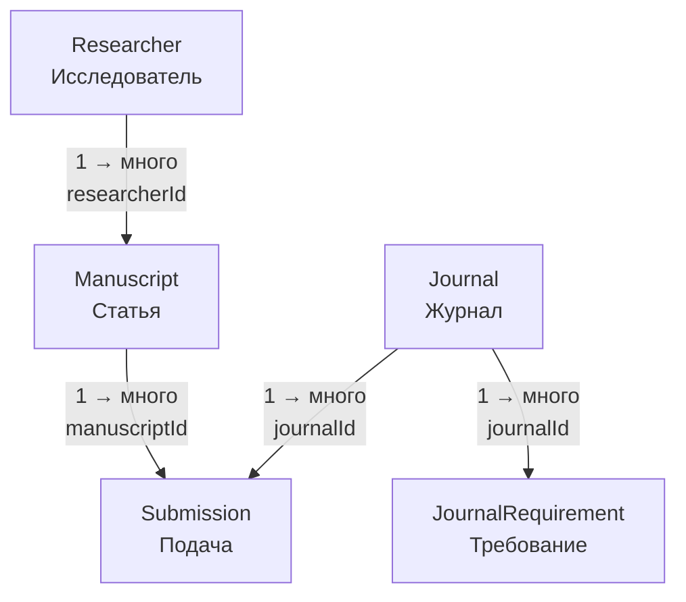
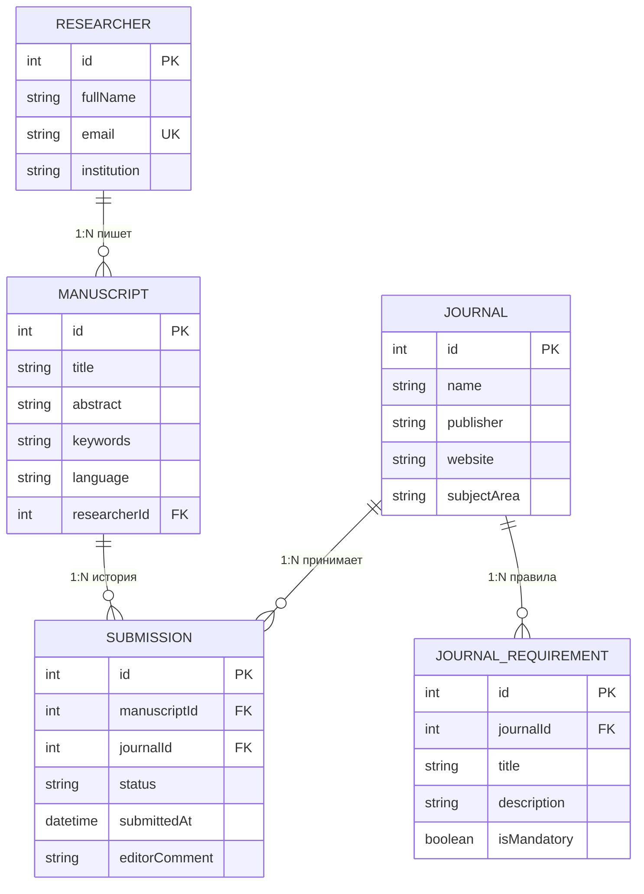

# PaperFlow — ERM (модель данных)

Простая схема базы: **5 таблиц** и связи между ними.

---

## Карта связей



Как читать:
- у **одного** Researcher — **много** Manuscript
- у **одной** Manuscript — **много** Submission (история попыток)
- у **одного** Journal — **много** Submission и **много** JournalRequirement
- Manuscript и Journal связаны **через** Submission

---

## Пример на данных

```text
Researcher id=1  Адина
   │
   └── Manuscript id=10  "AI in medicine"
         │
         ├── Submission id=100 → Journal id=5 "Nature"  status=REJECTED
         └── Submission id=101 → Journal id=7 "Lancet"  status=UNDER_REVIEW

Journal id=5 Nature
   ├── Requirement id=1  "Max 8000 words"
   └── Requirement id=2  "Anonymous review"
```

---

## ER-диаграмма с полями



---

## Таблицы

### 1. Researcher (Исследователь)

| Поле | Тип | Смысл |
|------|-----|--------|
| id | Int, PK | номер |
| fullName | String | ФИО |
| email | String, unique | почта |
| institution | String | вуз / организация |

### 2. Manuscript (Статья)

| Поле | Тип | Смысл |
|------|-----|--------|
| id | Int, PK | номер |
| title | String | название |
| abstract | String | аннотация |
| keywords | String[] | ключевые слова |
| language | String | язык |
| researcherId | Int, FK | чей автор → Researcher |

### 3. Journal (Журнал)

| Поле | Тип | Смысл |
|------|-----|--------|
| id | Int, PK | номер |
| name | String | название |
| publisher | String | издатель |
| website | String | сайт |
| subjectArea | String | предметная область |

### 4. JournalRequirement (Требование журнала)

| Поле | Тип | Смысл |
|------|-----|--------|
| id | Int, PK | номер |
| journalId | Int, FK | к какому журналу → Journal |
| title | String | название правила |
| description | String | описание |
| isMandatory | Boolean | обязательно ли |

### 5. Submission (Подача статьи)

| Поле | Тип | Смысл |
|------|-----|--------|
| id | Int, PK | номер |
| manuscriptId | Int, FK | какая статья → Manuscript |
| journalId | Int, FK | в какой журнал → Journal |
| status | Enum | статус публикации |
| submittedAt | DateTime | когда подали |
| editorComment | String? | комментарий редакции |

---

## Связи кратко

| От | К | Тип | Через поле |
|----|---|-----|------------|
| Researcher | Manuscript | 1:N | manuscript.researcherId |
| Manuscript | Submission | 1:N | submission.manuscriptId |
| Journal | Submission | 1:N | submission.journalId |
| Journal | JournalRequirement | 1:N | requirement.journalId |
| Manuscript ↔ Journal | M:N | через Submission | manuscriptId + journalId |

---

## Статусы Submission

| Статус | Значение |
|--------|----------|
| DRAFT | черновик |
| SUBMITTED | подано |
| UNDER_REVIEW | на рецензии |
| REVISION_REQUIRED | нужны правки |
| ACCEPTED | принято |
| REJECTED | отклонено |
| WITHDRAWN | отозвано |

Статус обновляет пользователь вручную.

---

## Словарь

| Сокращение | Значение |
|------------|----------|
| PK | Primary Key — уникальный id строки |
| FK | Foreign Key — ссылка на другую таблицу |
| UK | Unique — значение не повторяется |
| 1:N | один-ко-многим |
| M:N | многие-ко-многим (через промежуточную таблицу) |
